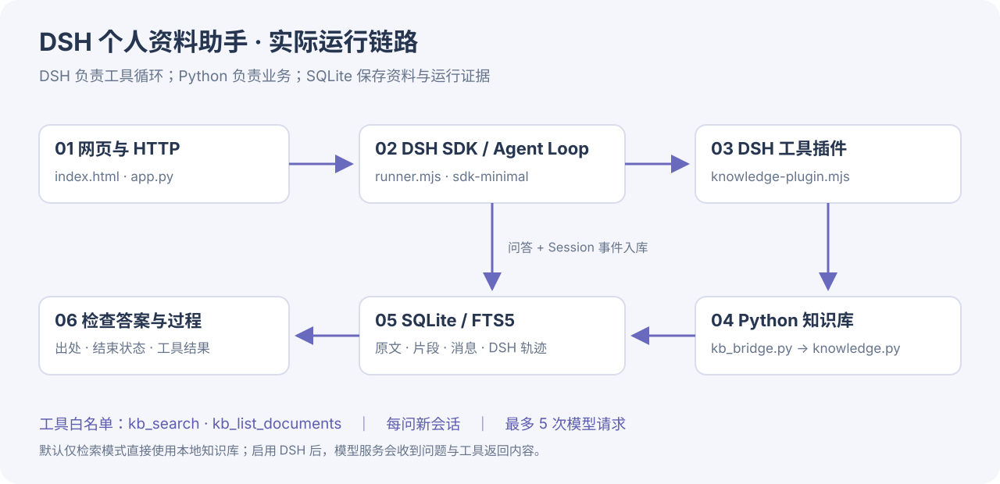

# Personal Knowledge Assistant｜DSH 个人资料助手

从零练习一个有数据库、有小型知识库、能调用工具的 AI 项目。本地单人教学版。

**Harness 使用 DeepSeek 官方 DSH `0.2.2-rc.1`**：官方 SDK 启动真实 DSH Agent 循环，模型调用知识库工具，工具结果返回模型，再生成带出处的回答。Python 负责网页、资料导入和 SQLite 持久化。

[从零动手](docs/tutorial.md) · **[DSH 接入实战教程与运行记录](docs/dsh-harness-tutorial.md)** · [AI 开发任务书](docs/BUILD_PROMPT.txt) · [真实 DSH 离线运行示例](docs/dsh-run-example.json)



## 1. 启动

需要 Python 3.10+（SQLite 支持 FTS5）；启用 DSH 还需 **Node.js ≥24.9.0**。建议使用 Node 24 LTS。DSH 仍是开发预览版，本仓库同时固定直接依赖版本和 package-lock.json。

```bash
git clone https://github.com/comaple/personal-knowledge-assistant.git
cd personal-knowledge-assistant
npm ci
python3 app.py
```

浏览器打开 http://127.0.0.1:8501 。Windows 使用 `py` 替换 `python3`。端口冲突时使用 `python3 app.py --port 8502`。

不安装 Node / 不执行 npm ci，也可以用 Python 启动并练习默认的“仅检索”模式；该模式不启动 DSH、不调用外部模型。

## 2. 先验证资料，再启用 DSH

1. 点击“导入示例资料”，导入两份虚构摄影课程说明。
2. 提问“摄影课退款需要提前多久申请？”，展开来源，应看到“至少 72 小时”。
3. 重复导入相同内容，文档数不增加。停止再启动，资料和消息仍在。
4. 复制 `.env.example` 为 `.env`，用编辑器填写 Key：

```dotenv
LLM_API_KEY=你的DeepSeekKey
DSH_MODEL=deepseek-flash
DSH_BASE_URL=https://api.deepseek.com/anthropic
```

重启服务，勾选“使用 DSH 智能体检索并回答”，再提问。页面底部可展开“智能体检索过程”。也支持进程环境里的 `DEEPSEEK_API_KEY`，优先使用非空 `LLM_API_KEY`。

**DSH 官方适配器使用 Messages 协议。**地址不是 `/chat/completions`；旧版 `LLM_BASE_URL` / `LLM_MODEL` 不再使用。若使用其他提供商，需要另接 DSH 对应适配器。

启用 DSH 后，问题、工具返回的文档名和检索片段会发送给模型服务，可能产生 API 费用。没有命中时，模型也已经参与检索决策；可以换词重查。最多 5 次模型请求，每次最多输出 1200 tokens，关闭思考模式，不自动重试，整次进程上限 150 秒。

**本次验证没有使用真实付费 Key。**已验证真实 DSH 运行时、官方模型适配器、本地模拟 Messages 服务、真实工具和数据库的完整链路；尚未验证真实模型的检索策略、回答质量或线上连通性。

## 3. 文件分工

| 文件 | 职责 |
| --- | --- |
| `index.html` / `app.py` | 页面、HTTP 接口、资料和会话管理 |
| `store.py` | SQLite 事务、文档、消息与 DSH 事件轨迹 |
| `knowledge.py` | 校验、去重、切块、FTS5 关键词检索 |
| `model_client.py` | 启动 Node 适配层、150 秒进程边界、回答验收 |
| `harness/runner.mjs` | 官方 `DeepSeekHarness` SDK、sdk-minimal profile、配置补丁 |
| `harness/knowledge-plugin.mjs` | Cordis 插件，向 DSH 注册两个知识库工具及五步限制 |
| `harness/kb_bridge.py` | 固定参数调用现有知识库，不接收 SQL / shell 命令 |
| `harness/integration.test.mjs` | 无 Key 的真实 DSH 集成测试 |
| `test_project.py` | 数据库、HTTP、出处验收与轨迹保存测试 |
| `inspect_db.py` | 查看表记录数 |

模型可用工具只有 `kb_search(query)` 和 `kb_list_documents()`。前者每次最多返回四个 800 字以内的片段；后者最多返回 100 个文档名和片段数。模型不能通过这些工具上传、删库、执行命令或选择数据库路径。

## 4. 数据和记忆

默认数据库是 `data/knowledge.db`，旧数据库启动时自动新增 `harness_runs` 表。

| 表 | 保存内容 |
| --- | --- |
| documents | 文件名、原文、内容摘要值、时间 |
| chunks | 文档 ID、序号、片段正文 |
| sessions | 应用会话 |
| messages | 问答、来源快照、状态 |
| harness_runs | 应用会话对应的 DSH 会话 ID、结束原因、完整 SDK Session 事件 |
| chunk_search | FTS5 索引，与片段 ID 对齐 |

每 800 字切块，重叠 120 字；中文相邻双字切分，英文按词；OR 匹配、BM25 排序。**这是关键词检索，同义表达可能漏检。**DSH 可以换词调用工具；测试里的换词由模拟模型脚本指定，不代表真实模型一定会这样做。

每个问题启动一个新的 DSH 会话。DSH 自动使用同一轮里的工具调用历史；应用旧聊天保留用于回看，**不自动传给下一轮模型**。这不等于模型训练或跨轮记忆。

每次使用独立临时 DSH home，避免混入全局插件配置。SDK 运行期间由 DSH 自己生成 Session 日志；进程关闭后，把 SDK 返回的 Session 事件与问答原子写进 SQLite，临时 home 随后清理。`/api/runs?session_id=应用会话ID` 可查看保存的轨迹。

删除文档会删除原文、片段和索引；历史消息及 DSH 轨迹仍包含当时的证据。删除对应会话会一并清除消息、来源快照与轨迹。停止服务后可备份整个 data 目录。

## 5. 验收

```bash
python3 -m unittest -v test_project.py
npm run test:harness
```

测试只用临时数据库、虚构资料和本地模拟服务，不读取 .env、不请求付费模型。Python 测试共 9 项，DSH 集成测试共 4 项；CI 同时运行。Python 命令不是 `python3` 时，通过 `PKA_TEST_PYTHON` 指定，例如 macOS/Linux：`PKA_TEST_PYTHON=python npm run test:harness`。

编号验收会拒绝没有检索、工具全部失败、无出处、非法出处和未正常结束的回答。**编号存在不能证明事实受原文支持**，仍须展开来源核对。

## 6. 教学范围

只监听 127.0.0.1，无账号和租户隔离，上传 UTF-8 TXT/Markdown（每份 ≤1 MB）、问题 ≤1000 字。模型只获知识库读工具；DSH 的 shell、文件读写和工作目录工具已禁用，并另加工具白名单。这是应用的能力范围，不是对整个 Node/Python 进程的系统级沙箱保证。

无扫描 PDF/OCR、向量数据库、跨轮指代消解、常驻 DSH 进程。本版每问启动一次运行时，便于隔离和讲解，会有启动开销。

## 官方参考

- https://github.com/deepseek-ai/deepseek-harness
- https://github.com/deepseek-ai/deepseek-harness/tree/master/packages/sdk/client
- https://github.com/deepseek-ai/deepseek-harness/blob/master/docs/cookbook/adding-a-tool.md
- https://www.sqlite.org/fts5.html
