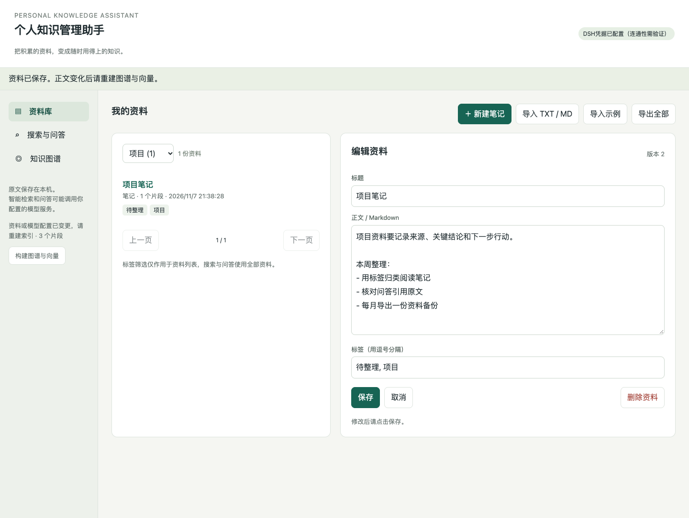

# 个人知识管理助手 · Personal Knowledge Assistant

本地单人知识管理应用：导入资料、创建和编辑 Markdown 笔记、用标签整理、搜索原文、查看知识图谱，并由 DSH 调用工具完成有出处的问答。

**当前版本：1.0.0-rc.1。**核心工程链路使用真实 DSH、LightRAG 和 SQLite 验证；模型和向量在离线测试中由模拟服务提供。真实模型质量验收尚待配置服务，不能将离线测试等同于实际问答效果。

[文档入口](doc/README.md) · [PRD](doc/PRD.md) · [Spec](doc/SPEC.md) · [验收](doc/VERIFY.md) · [任务进度](doc/TASKS.md) · [OpenAPI](doc/openapi.json)



*真实浏览器和应用页面，使用虚构资料；图谱与 DSH 演示采用本地模拟模型和 8 维测试向量。*

## 开始使用

参考环境：Python 3.12；DSH 需要 Node.js ≥24.9.0。SQLite 必须支持 FTS5。无 Key 也能导入、记笔记、编辑、加标签、本地关键词检索、回看历史和导出。

```bash
git clone https://github.com/comaple/personal-knowledge-assistant.git
cd personal-knowledge-assistant
python3.12 -m venv .venv
source .venv/bin/activate
python app.py
```

Windows PowerShell：使用 `py -3.12 -m venv .venv` 和 `.venv\Scripts\Activate.ps1`。应用打开 http://127.0.0.1:8501；端口冲突可加 `--port 8502`。`--db` 可指定独立数据库。

配置图谱、向量与 DSH：

```bash
python -m pip install -r requirements-rag.lock
npm ci
cp .env.example .env
```

将 `.env` 中的模型配置填好后重启。PowerShell 用 `Copy-Item .env.example .env`。不要覆盖已有配置文件。

```dotenv
LLM_API_KEY=你的Key
DSH_MODEL=deepseek-flash
DSH_BASE_URL=https://api.deepseek.com/anthropic
RAG_ENABLED=true
RAG_LLM_BASE_URL=https://api.deepseek.com
RAG_LLM_MODEL=deepseek-flash
RAG_LLM_API_KEY=
EMBEDDING_BASE_URL=http://127.0.0.1:11434/v1
EMBEDDING_MODEL=bge-m3
EMBEDDING_DIM=1024
EMBEDDING_API_KEY=ollama
```

本地 Embedding 示例：先安装/启动 Ollama，并运行 `ollama pull bge-m3`。也可配置其他兼容 `/embeddings` 的服务及实际维度。DSH 使用 Messages，图谱/重排使用 Chat Completions，两个地址不能混用；模型别名与服务可用性需要实际验证。

## 使用流程

1. 在资料库导入 TXT/Markdown，或新建笔记；点击标题编辑正文和标签。
2. 标签筛选仅作用于资料列表，搜索和问答使用全部资料。
3. 默认“关键词（本地）”不调用模型。多路检索和 DSH 问答可能使用模型/Embedding 服务并产生费用。
4. 主动点击“构建图谱与向量”，确认数据发送范围后等待完成；正文更新或删除后需重建。
5. 在知识图谱点击实体/关系回查原文；答案引用显示当时保存的原文快照。
6. “导出全部”生成 Markdown + metadata.json ZIP，不包含聊天或系统备份。

每份正文 ≤1 MB，全库 ≤500 片段；自动按800字符切块、重叠120。保存有版本冲突时拒绝覆盖并保留输入。删除资料停止当前检索，但历史引用和磁盘旧索引仍可能保留。

## 检索和 Harness

- SQLite FTS5/BM25、LightRAG 文本向量、实体关系三路召回。
- 每路12候选，合并去重至24，再基于原文重排选4段；失败明确降级，不编造融合分数。
- DSH 注册 `kb_search`、`kb_list_documents`、`kb_graph_schema`、`kb_graph_query` 四个只读工具。
- 图计划最多3跳，返回完整路径和原文；图谱由模型抽取，路径存在不代表事实已核验。
- 每轮独立 DSH 会话，旧聊天不会自动注入下一问；SQLite 保存消息、引用和已返回轨迹。
- 问答期间资料变化则拒绝旧结果；索引分代构建，成功后才切换指针。

预算：DSH 最多5次模型请求、8次知识工具调用；整轮150秒，索引30分钟。检索内部有额外 API 调用，步数不等于总调用次数或金额上限。服务仅监听本机，不提供多用户认证和公网部署。

## 备份、恢复和清理

先停止应用；维护进程与应用共享数据库独占锁。以下操作拒绝覆盖已有目标：

```bash
python maintain.py backup --db data/knowledge.db --output backups/2026-11-07
python maintain.py restore --backup backups/2026-11-07 --db data/restored.db
python app.py --db data/restored.db
```

备份包含资料、标签、会话、消息、引用及轨迹；恢复后图谱/向量需重建。首次打开旧版本数据库会保存 `.pre-v2-*.db` 原库备份并迁移，未知格式拒绝升级。

彻底清除该数据库的旧派生索引：停服后执行 `python maintain.py clean-index --db data/knowledge.db`。它不删除聊天历史。数据库与索引没有加密，按个人本机应用管理文件访问权限。

## 开发与验收

```bash
python -m pip install -r requirements-dev.lock
python -m unittest -v test_project.py test_rag
npm run test:harness
```

完整图谱测试还需安装 `requirements-rag.lock`，并安装 Node/DSH。缺 LightRAG 时集成测试会明确 skipped，不能视为完整通过。自动化通过数和验证范围以 [验收报告](doc/verification/REPORT.md) 为准。

可选浏览器检查：配置 `PKA_PUPPETEER_PATH`、`PKA_CHROME_PATH` 后运行 `python scripts/run_ui_check.py`。本地500片段性能检查：`python scripts/benchmark_local.py`，仅使用临时数据库。

真实质量验证先启动**隔离空数据库**，配置真实模型与 Embedding，再运行：

```bash
python app.py --db data/acceptance.db --port 8502
# 另一个终端：会导入固定8份虚构资料、构建索引并产生模型调用
python evaluate.py --url http://127.0.0.1:8502 --mode all
```

评估器自动记录证据覆盖、耗时和响应；完整回答、正确拒答、冲突与事实支持需按20题人工复核，不会自动编造质量分数或未提供的费用。缺 Key 时先拒绝智能评估，不向日常资料库混入测试数据。

所有正式文档、教程、图片、固定语料与验收记录统一在 `doc/`；不再使用 `docs/`。
