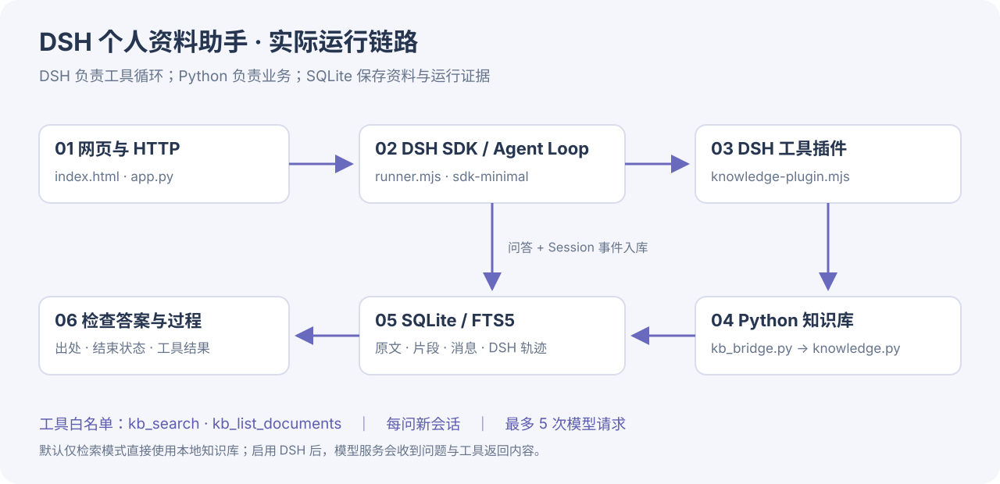
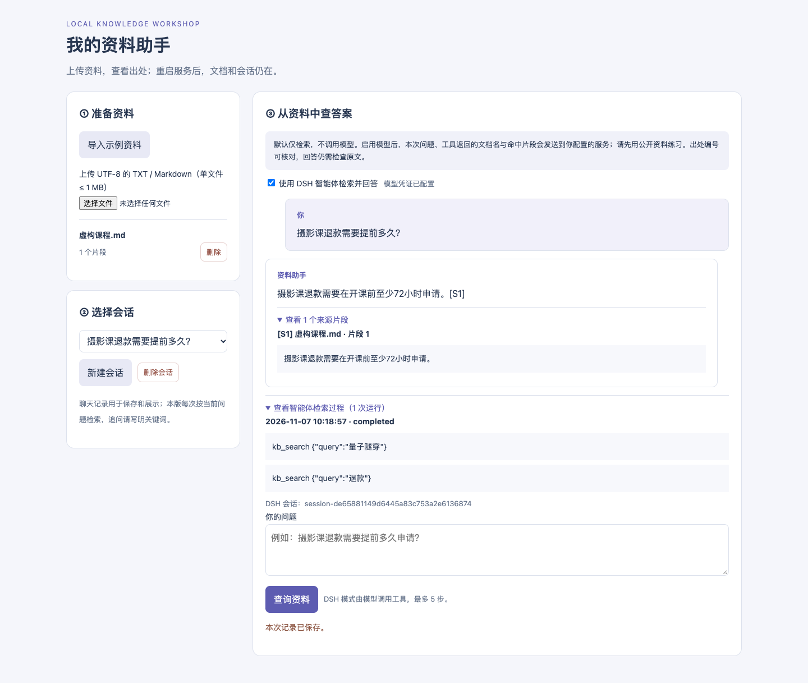

# 从手写问答流程到 DSH Harness：一次真实接入记录

**8 个知识点 · 阅读约 10 分钟 · 可复制运行**

项目：https://github.com/comaple/personal-knowledge-assistant

本文记录 2026-11-07 实际完成的改造。使用 DeepSeek 官方 DSH **0.2.2-rc.1**。本机 Node v25.3.0、npm 11.7.0、Python 3.14；DSH 包要求 Node ≥24.9.0，项目 Python 最低为 3.10。

> **Harness 的核心工作，是在“模型提出工具调用”和“工具返回结果”之间维持可继续执行、可记录、可检查的运行过程。**

## 01｜先明确：DSH 到底负责哪一部分

原版是一条 Python 固定流程：检索 → 拼提示词 → 直接请求模型 → 返回答案。

新版把问答控制交给 DSH。页面和数据库不必重写：Python 接问题，官方 SDK 启动 DSH，模型选择知识库工具；DSH 执行、记录并把结果交给下一次模型请求，直到结束。



| 组件 | 这次承担的工作 |
| --- | --- |
| DSH Agent Loop | 模型请求、工具执行、后续步骤和结束状态 |
| DSH Tools / Cordis | 工具 schema、参数校验、注册和执行 |
| DSH Session | 记录每次模型输入、工具调用与结果、步骤和结束原因 |
| 我们的业务代码 | 资料入库、FTS5 检索、页面、SQLite 保存、最终验收 |

**本项目没有另写一套 while 循环来冒充 DSH，也没有只让 DSH 帮忙写代码。DSH 是运行问答时实际工作的 Harness。**

## 02｜从空终端到本地知识库

```bash
git clone https://github.com/comaple/personal-knowledge-assistant.git
cd personal-knowledge-assistant
node --version
python3 --version
npm ci
python3 app.py
```

Windows 使用 `py` 替换 `python3`。浏览器访问 http://127.0.0.1:8501 。点击“导入示例资料”，先不勾 DSH，查询退款规则，展开原文确认“至少 72 小时”。

**先证明资料真的能查到，再检查模型是否会使用工具。**这能把知识库问题和 Agent 问题分开排查。

这次我先用 `npm view @deepseek-ai/dsh version engines dist-tags --json` 核对官方发布包，再固定三个直接依赖：`dsh`、`dsh-sdk-client`、`dsh-tools` 均为 0.2.2-rc.1，并提交 npm 生成的 package-lock.json。读者直接 `npm ci` 安装锁定依赖，不必再次追最新版。

## 03｜把已有检索函数变成模型可调用的工具

业务函数原本就在 `knowledge.py`：`retrieve(store, question)` 返回最多四个片段。新增 `harness/kb_bridge.py`，让 Node 能用固定协议调用它。

```text
输入：{"query":"退款"}
操作：kb_search
输出：[{"source_id":"S1","content":"摄影课退款……","name":"虚构课程.md", ...}]
```

Python 与 Node 通过子进程 stdin/stdout 传 JSON。参数以 argv 数组传递，不拼 shell 命令；数据库路径和 Python 路径由服务配置，模型只能给检索词。另一个操作 `kb_list_documents` 返回前 100 份文档的名称和片段数。

`source_id` 用片段数据库 ID 生成，例如 S17。**同一轮改词检索时，同一片段的引用编号不变。**它不是每次结果排名：第一个结果不一定叫 S1。

在 `harness/knowledge-plugin.mjs` 中，插件声明 `inject = ['tools']`，等工具注册表就绪，再调用官方 API：

```js
ctx.tools.register(defineTool({
  name: 'kb_search',
  description: '查询本地资料，返回原文片段和可引用的 source_id。',
  parameters: {
    query: { type: 'string', required: true },
  },
  output: {
    schema: { type: 'array', items: sourceSchema },
    render: (_args, value) => [{ type: 'text', text: JSON.stringify(value) }],
  },
  execute: (args, exec) => invoke(config, 'kb_search', args, exec.signal),
}));
```

这是项目中的核心代码节选，`sourceSchema` 与 `invoke` 的完整定义见插件文件。`defineTool` 校验参数和规范返回值；`execute` 完成真实查询；`render` 把规范结果转换为模型能看到的文本。工具执行跟随 `exec.signal` 取消，另外设置 10 秒子进程边界。

## 04｜用 profile 和 patch 组装能力

DSH 的 sdk-minimal 是官方自带的 SDK 配置。它依然带有文件和 shell 能力，所以不能直接拿默认配置充当资料助手。

`harness/runner.mjs` 每次生成一个配置补丁，做四件事：

- 禁用 `tool-fs`、`tool-working-directory`、`persistent-bash`、`persistent-pwsh`。
- 插入本地知识库插件，插件路径使用绝对路径。
- 替换系统提示：先用工具找资料，只根据正文回答，事实带出处，资料不足就说明。
- 配置官方 DeepSeek 适配器：关闭思考、关闭自动重试、限制输出。

JSON 是 YAML 的子集，因此代码直接把补丁数组写入临时 `knowledge.patch.yml`；不需要读者手工改机器路径。

此外，在 `agent/created` 上为每个 Agent 设置工具白名单：

```js
agent.ctx.tools.restrict({ allow: ['kb_search', 'kb_list_documents'] });
```

**删掉默认工具生产者，再限制注册表实际可见的工具，才能把能力范围落到代码上。**这也不是完整进程沙箱：可信插件和业务代码仍在本机 Node/Python 中执行。

插件还监听 `agent/pre-step`，超过 5 次模型请求就抛错结束。这里的一步是“一次模型请求及它触发的工具调用”，不是一个工具调用；一次请求可能同时提出多个工具调用。

## 05｜交给官方 SDK 运行，不自己驱动模型循环

核心启动代码如下，完整实现在 `harness/runner.mjs`：

```js
const harness = new DeepSeekHarness({
  profile: 'sdk-minimal',
  dshHome: input.home,
  patches: [patchPath],
  cwd: root,
  processCwd: root,
  provider: 'deepseek-official',
  model,
  maxTokens: 1200,
  initializeTimeoutMs: 30_000,
  requestTimeoutMs: 120_000,
});
try {
  const run = await harness.run(input.question);
  // 取 finalResponse、finishReason、sessionId、events，并收集成功检索的来源。
} finally {
  await harness.close();
}
```

**SDK 通过标准 dsh launcher 启动运行时，再通过 stdio JSON-RPC 驱动 Agent。**`harness.run()` 返回前，DSH 已经处理这轮内部的多次模型请求与工具结果。`close()` 负责退出子进程。

Python 的 `model_client.py` 只负责启动这段适配代码和验收结果，不再直接调用模型 HTTP 接口。整次运行超过 150 秒时，应用终止对应进程树。

每问使用独立临时 DSH home，不读取你全局 DSH 插件配置；每问也是新 DSH 会话。**同一轮会使用工具历史，跨轮旧聊天不自动注入模型。**教程里的“有记忆”首先指资料、消息和轨迹可持久化，不代表模型记住了一切。

## 06｜接真实模型：这里要用 Messages 接口

```bash
cp .env.example .env
```

Windows PowerShell 使用 `Copy-Item .env.example .env`。用编辑器填写：

```dotenv
LLM_API_KEY=你自己的DeepSeekKey
DSH_MODEL=deepseek-flash
DSH_BASE_URL=https://api.deepseek.com/anthropic
```

重启 Python 服务，勾选 DSH 问答。不要把这里的地址改成旧项目的 `/chat/completions`；**本次使用的 DSH 官方适配器走 Messages 协议**，它会在基础地址后访问 `/v1/messages`。

旧字段 `LLM_BASE_URL`、`LLM_MODEL` 不再使用。模型名会变动，今后以提供商与所用 DSH 版本的支持情况为准。

DSH 模式在检索前就需要模型决策，所以没查到资料也可能产生费用。最多 5 次请求不是费用保证；每步的输入还包括提示词、工具定义和这一轮已积累的工具结果。

**交付时环境没有真实 Key，因此这一节是给你的线上运行步骤，不写成已经完成的线上验证。**

## 07｜把“它说完成了”变成可检查的运行记录

应用只接受正常结束的运行：`finish_reason == 'completed'`。还要确认调用过检索工具、有成功的检索结果事件，以及回答使用了合法出处编号。

- 没调用工具：拒绝。
- 检索工具全部失败：报错，不当作“没有资料”。
- 成功检索但没有命中：应用固定返回“没有检索到相关资料”。
- 有资料但没有出处，或引用不存在的 S 编号：拒绝。
- 五步用完、请求失败或输出中断：不当作成功答案。

**这些检查不能证明内容忠实，也不能完全抵御文档中的提示注入。**先把出处与状态检查做实，再由读者核对原文。



*实际页面验证截图：真实 DSH + 本地模拟模型 + 虚构课程资料。可以同时核对回答、来源与两次检索；截图不代表真实线上模型表现。已检查 1440 像素桌面和 390 像素手机宽度，手机无横向溢出。*

DSH 在运行期间管理自己的 Session 日志。SDK 返回的完整 Session 事件随后保存进 SQLite 的 `harness_runs`，与本轮消息共用一个事务。它包含 DSH 会话 ID、结束原因、模型输入、工具调用及结果等。临时 home 在关闭后清理。

页面能展开检索过程；开发者可查看 `/api/runs?session_id=应用会话ID`，或用 SQLite 读取 `events_json`。以下事件是排查的主线：

```text
step/start
assistant/message
  tool/call   kb_search {query: ...}
  tool/result 原文或空结果
step/end
下一次 step/start
……
turn/end      completed / error / ...
```

已收到 SDK 结果的失败运行，也会保留其事件；若启动失败、传输中断或进程被硬终止，未返回给应用的事件可能无法落库。本版不实现崩溃后的 DSH 会话续跑。

删除文档不会抹去历史消息和轨迹里的原文快照；删除会话会级联清除这些记录。保持这条规则，才能解释“新检索查不到，旧记录还看得到”。

## 08｜本次实际跑了什么：可以复现的验证

```bash
python3 -m unittest -v test_project.py
npm run test:harness
```

本机集成测试指定 Python 可执行文件的实际命令是：

```bash
PKA_TEST_PYTHON=/usr/local/bin/python3.14 npm run test:harness
```

`PKA_TEST_PYTHON` 只影响测试。正式应用自动把启动服务的 Python 路径传给桥接脚本。Windows 可以在 PowerShell 中用 `$env:PKA_TEST_PYTHON='python'` 指定已安装的 Python 命令。

本次通过 **9 项 Python 测试 + 4 项真实 DSH 集成测试**：

| 验证 | 实际发生的事 |
| --- | --- |
| 改词检索 | 模拟模型先发“量子隧穿”，真实工具返回空；随后发“退款”，真实 SQLite 返回 72 小时；第三次请求带引用作答 |
| 无资料 | 工具真实返回空，DSH 正常结束，应用不采纳无证据内容 |
| 步数限制 | 模拟模型持续调工具，执行到 5 次模型请求后运行停止，结束原因不是 completed |
| 整条应用链路 | HTTP 请求 → Python → Node SDK → DSH → 知识库 → 回答 → SQLite 消息与事件轨迹 |

Python 测试还覆盖去重、事务回滚、重启读取、删除同步、引用验收、无 Key 不启动运行时，以及失败轨迹保存和会话级联删除。

可打开 [dsh-run-example.json](dsh-run-example.json)，查看这次真实 DSH 产出的工具事件节选与答案。示例中模型行为由本地服务脚本指定，资料为虚构；**它证明框架接通，不证明真实大模型会稳定改词、正确推理或给出好答案。**

### 这次接入中需要特别记住的细节

1. 插件地址必须是绝对路径。补丁文件所在目录不会自动成为模块解析根目录。
2. DSH 与 SDK 固定同一版本，避免开发预览 API 漂移。
3. 工具结果的引用标识必须跨检索稳定，不能反复把不同片段都叫 S1。
4. 不仅判断有没有回答，还要检查结束状态、成功工具结果和出处。
5. 测试直接跑真实 DSH；只把付费模型端换成本地模拟服务，才能检查配置、适配器、事件和工具是否真的相互兼容。

## 官方依据

本次先阅读官方源码及文档，再对发布包实际运行。查阅的上游提交为 `fcc0ad462172522aaf5c93a7b2e01f6b9f0b0159`；以下链接固定在该提交：

- [DSH 架构、profile 与 Agent 循环](https://github.com/deepseek-ai/deepseek-harness/blob/fcc0ad462172522aaf5c93a7b2e01f6b9f0b0159/docs/architecture.md)
- [官方 TypeScript SDK](https://github.com/deepseek-ai/deepseek-harness/tree/fcc0ad462172522aaf5c93a7b2e01f6b9f0b0159/packages/sdk/client)
- [工具开发接口](https://github.com/deepseek-ai/deepseek-harness/blob/fcc0ad462172522aaf5c93a7b2e01f6b9f0b0159/docs/cookbook/adding-a-tool.md)
- [sdk-minimal 默认组成](https://github.com/deepseek-ai/deepseek-harness/tree/fcc0ad462172522aaf5c93a7b2e01f6b9f0b0159/packages/bundle/sdk-minimal)
- [DeepSeek 官方适配器配置与 Messages 地址](https://github.com/deepseek-ai/deepseek-harness/blob/fcc0ad462172522aaf5c93a7b2e01f6b9f0b0159/packages/llm/llm-deepseek/src/config.ts)
