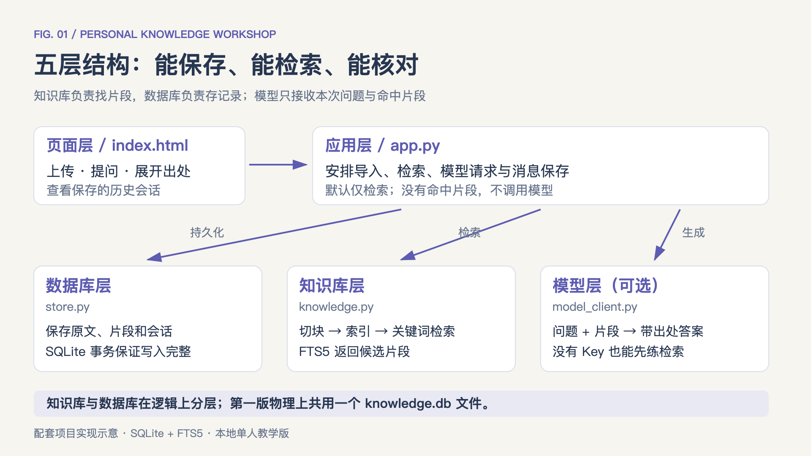
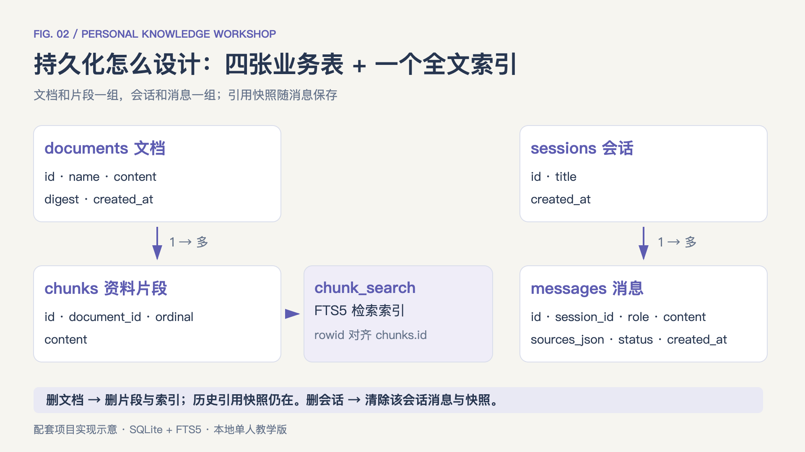
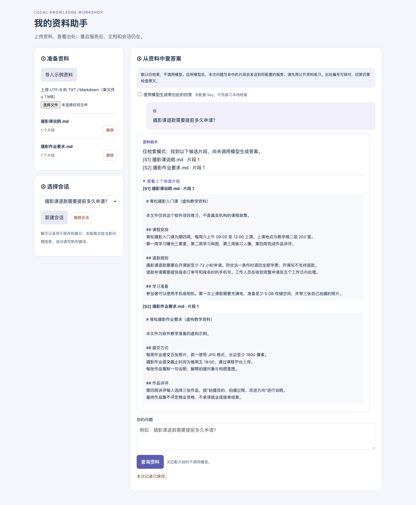

# 从零做一个有记忆的 AI 助手：数据库、知识库、问答，一次跑通

**8 个动手步骤 · 阅读约 8 分钟 · 附最小项目源码与开发任务书**

项目源码：https://github.com/comaple/personal-knowledge-assistant

配套代码与启动说明：[仓库首页](../README.md)。完整开发任务书：[BUILD_PROMPT.txt](BUILD_PROMPT.txt)。

项目代码与本文为独立教学实现。摄影课程资料为虚构练习数据；第一版面向本地单人使用。

这次，做一个你自己就能用上的东西：**把课程笔记、项目说明上传进去，直接提问，答案能找到出处；关掉程序再打开，资料和聊天记录还在。**

我们叫它“个人资料助手”。用两份虚构的摄影课程文件练习：问退款规则，能查到“至少提前 72 小时”；问“量子隧穿”，会提示没有检索到资料。

从需求、页面、后端到数据库和知识库，这个小项目能把整条链路串起来。配套源码和 AI 开发任务书一并提供，既可以先运行观察，也可以让编码助手按任务书从头搭建。

> **先做出一个能保存、能检索、能核对的资料助手，再逐步扩展更复杂的 Agent 能力。**

## 01｜先定一个能验收的需求

第一版只做四件事：上传 TXT 或 Markdown；根据资料查询；展开原文出处；重启后恢复文档与会话。先不加入扫描 PDF、多人账号或自主执行复杂任务。

把需求写成一句开发指令：**“做一个本地个人资料助手，资料与聊天记录存 SQLite，先检索相关片段，再根据片段回答。”**这句话明确了数据从哪里来、怎样使用，以及哪些东西需要长期保存。

动手前，先记下要问的问题：“摄影课退款需要提前多久申请？”后面每完成一层，都围绕这个问题检查结果。

## 02｜把系统拆成五层，看清数据怎么走

这个项目包含五层，各自只负责一类工作：

- **页面层**：上传文件、输入问题、查看聊天与出处。
- **应用层**：接收请求，安排导入、检索和问答流程。
- **数据库层**：长期保存原文、片段、会话和消息。
- **知识库层**：把资料切块，建立索引，找出候选片段。
- **模型层**：读本次问题和检索结果，生成带出处的答案。

数据库层和知识库层是职责上的区分。第一版可以共用同一个 SQLite 文件，不必为每一层都部署一个服务。

> **数据库让资料留下来；知识库让相关资料找得到。持久化和检索，需要分别做好。**

*对应配套项目的实际模块分工。数据库与全文检索索引共用 SQLite；模型调用是可选步骤，页面默认仅检索。*

## 03｜先启动页面，完成第一次本地检索

安装 Python 3.10 或更新版本，下载配套项目，进入包含 app.py 的项目文件夹。这个版本只用 Python 自带组件，不需要安装额外依赖。

macOS / Linux 运行 `python3 app.py`；Windows 运行 `py app.py`。打开浏览器访问 `http://127.0.0.1:8501`，就能看到上传区、会话列表和提问区。

先点击“导入示例资料”，再问退款问题，展开来源，检查能否看到“至少 72 小时”。**默认的“仅检索”模式不会调用模型；先验证资料能够进来、能够找出，再接生成能力。**

## 04｜加上数据库，让重启不再丢记录

程序运行后，会在 data 目录生成 knowledge.db。它包含四张业务表：

- **documents**：文件名、原文、内容摘要值和导入时间。
- **chunks**：文档 ID、片段序号和正文。
- **sessions**：会话 ID、标题和创建时间。
- **messages**：问题、回答、来源快照、运行状态和时间。

片段通过文档 ID 关联原文，消息通过会话 ID 归属某次聊天。原文、片段和检索索引一起写入事务，发生异常时一起回滚，避免只保存了一半。

这一关要亲手检查：导入资料、问一个问题，按 Ctrl+C 停止程序，再启动。文档列表和聊天记录应当还在。也可以运行 `python3 inspect_db.py`，查看各张表的记录数。

*documents 与 chunks、sessions 与 messages 分别关联。chunk_search 是 FTS5 虚拟表，以片段 ID 对齐；历史消息另外保留当时使用的来源快照。*

## 05｜做一个小型知识库：导入、切块、索引、检索

文件存进数据库以后，还需要能找到与问题相关的部分。配套代码会先校验文本，再按内容摘要值去重，把原文切成每段最多 800 个字符、相邻重叠 120 个字符的片段。

重叠是为了减少一句话或一个条件刚好被切断的影响。这些数值是入门项目的设计选择，可以修改，不是通用最优参数。

接着建立 SQLite FTS5 全文索引。中文按相邻双字形成检索词，英文按词处理；提问时匹配这些词，按 BM25 排序，取前 4 个候选片段。**这是关键词检索，同义表达可能漏检，也可能找回只有字面相关的内容。**

上传一份自己写的 TXT 或 Markdown，试着换两种问法。先观察返回片段是否相关，再考虑以后是否需要向量检索。知识库这一关的目标，是能解释“这段资料为什么被找回来”。

## 06｜再接模型：让答案带着出处回来

这条流程叫 RAG，英文是 Retrieval-Augmented Generation，检索增强生成：先找资料，再带着资料生成回答。它不需要把新资料训练进模型权重。

把 .env.example 复制为 .env，用文本编辑器填写自己的 LLM_API_KEY，确认服务地址与模型名，然后重启程序。页面勾选“使用模型生成带出处的回答”，再提交问题。具体字段与命令都放在项目 README 中。

应用发送本次问题和最多 4 个命中片段，并为片段标上 [S1]、[S2] 等编号。提示模型只依据这些内容回答；没有命中片段时，直接返回未找到资料，不发起模型请求。

**调用外部模型时，问题与选中的片段会发给对应服务。**先用示例或公开资料练习。界面可以展开每条来源；编号合法，也仍然要核对回答是否真的受原文支持。

> **应用保存了资料，不代表模型学会了资料。这里通过检索，把需要的内容放进本次输入。**

## 07｜让会话可回看，让删除行为讲得清楚

每次查询后，问题、结果、运行状态与来源快照都会落库。重启程序后，选择旧会话，就能看到当时查了什么、引用了哪段内容。

这个版本的历史消息用于保存和展示，**不会自动全部发给模型；每次仍按当前问题检索。**追问时写明课程名等关键词。以后再增加问题改写与多轮上下文，才能更好地处理“那它呢”这样的指代。

删除文档时，原文、片段和检索索引一起移除，它不再参与新检索。历史会话里的证据快照仍保留，方便回看；删除对应会话，才会清除那次聊天及其快照。这个规则在页面中有明确提示。

*本地运行截图：导入两份虚构摄影课程资料，在“仅检索”模式下查询退款条件并展开来源。截图未使用真实模型生成答案。*

## 08｜按结果验收，再决定下一步扩展

最后，把下面这些操作亲手走一遍：

- 重复导入同一内容，文档数不增加。
- 查询退款条件，来源里能找到“至少 72 小时”。
- 问“量子隧穿”，明确提示没有检索到资料。
- 停止并重启服务，文档和会话仍然存在。
- 删除某份文档，新检索不再返回它。
- 模型调用失败，能看到原因，本地资料仍在。

配套项目提供 `python3 -m unittest -v test_project.py`，检查持久化、检索、删除、事务回滚及接口处理。外部模型部分用本地模拟服务验证，没有用真实付费 Key 代替你做线上验收。

到这里，你已经接触了页面、后端、数据库、知识库和模型接口。下一步可以根据遇到的问题，再添加 PDF 解析、向量检索或多轮上下文。**每次增加一个能力，同时增加一条能亲手检查的验收条件。**

> **你的第一个项目，可以很小：两份资料、几个问题、一份数据库文件。亲手把上传、保存、检索、回答和重启恢复串起来，这些开发概念就有了具体的落点。**
